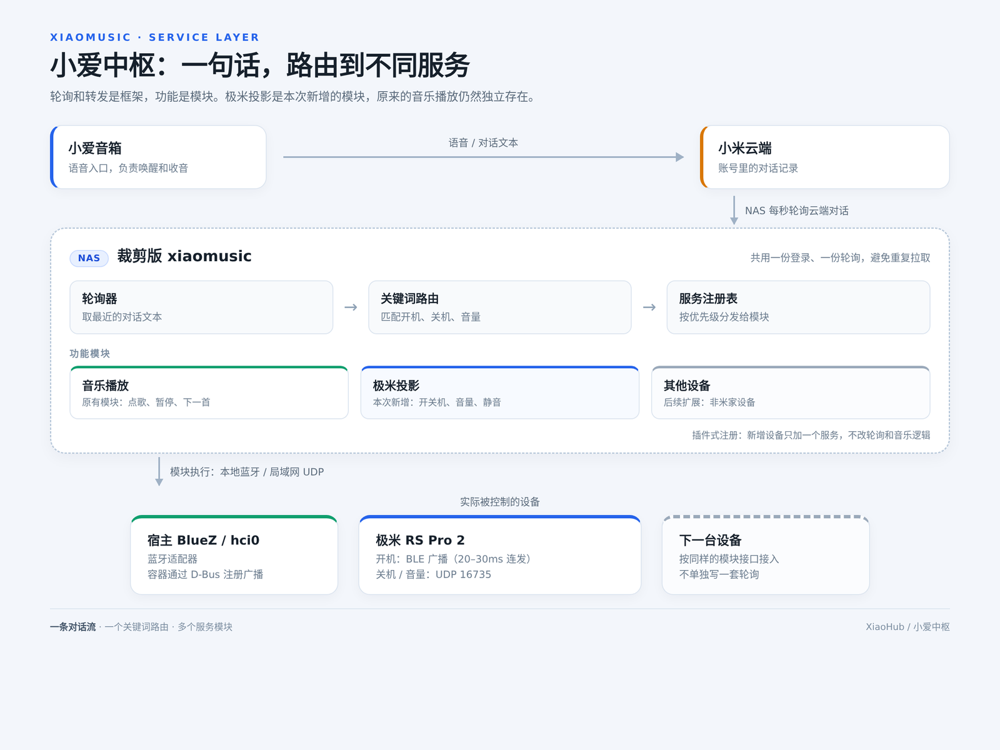
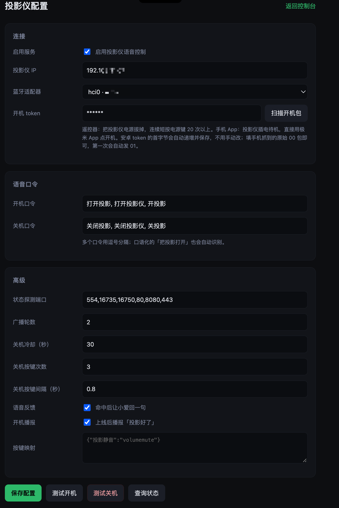
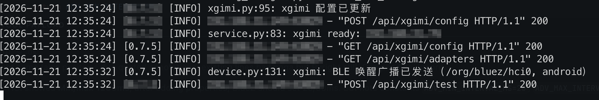
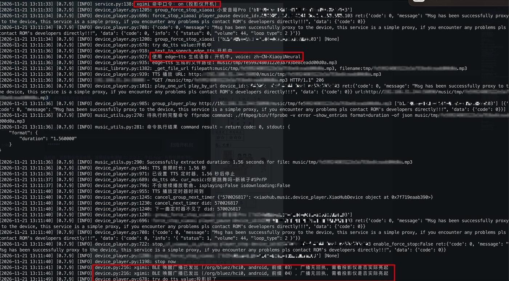

# XiaoHub · 小爱中枢

> 把小爱音箱变成一套本地语音中枢：一条对话轮询，按关键词分发给音乐、投影仪和任意可插拔的服务。
>
> 作者：**飘落的数码折腾日记**

[](LICENSE)




> 架构图来自公众号原文，图中的「裁剪版 xiaomusic」就是现在的 XiaoHub。

XiaoHub 基于 [hanxi/xiaomusic](https://github.com/hanxi/xiaomusic) 改造。原项目解决「小爱音箱播放 NAS 音乐」，XiaoHub 把它拆成「语音轮询 + 服务注册表 + 可插拔能力」：音乐仍是原来的音乐模块，投影仪是新增的第二个模块，后面接灯、风扇、插座不需要再写一套登录和轮询。

上游 xiaomusic 已宣布停止维护；本仓库是独立分支，保留原项目的 MIT 授权与版权声明。

**这不是小米或极米的官方项目。** 所有设备控制都在你自己的局域网里完成，语音文本仍然来自小米账号的对话记录；使用前请先看[隐私与安全](#隐私与安全)。

## 目录

- [能做什么](#能做什么)
- [架构](#架构)
- [快速开始](#快速开始)
- [投影仪配置](#投影仪配置)
- [语音口令](#语音口令)
- [配置参考](#配置参考)
- [新增一个服务](#新增一个服务)
- [隐私与安全](#隐私与安全)
- [兼容性与限制](#兼容性与限制)
- [开发](#开发)
- [故障排查](#故障排查)
- [从 xiaomusic 迁移](#从-xiaomusic-迁移)
- [关注公众号](#关注公众号)
- [致谢与 License](#致谢与-license)

## 能做什么

| 能力 | 说明 |
|---|---|
| 音乐播放 | 本地曲库、歌单、收藏、随机/循环、在线搜索下载（B 站 / yt-dlp）；原有口令全部保留 |
| 投影仪控制 | 「打开投影 / 关闭投影 / 投影静音 / 声音大点」→ BLE 唤醒或局域网 UDP 按键，不需要 Home Assistant、不需要红外盒子 |
| 网页配置 | 扫描开机包、选蓝牙适配器、改口令、测试开关机、查询状态，保存后热重载 |
| 可插拔服务 | 一个 `Service` 子类就是一个能力；注册表按优先级分发，音乐是最后的兜底 |
| 单份轮询 | 整个进程只有一条小米对话轮询、一份账号登录，新增设备不会重复拉取、不会触发限流 |
| 干净的出站 | 没有 GA / Umami / Sentry / vConsole / Google Fonts / 外部 CDN；前端资源本地化 |
| Docker 部署 | bridge + 端口映射；配置、缓存、曲库持久化；容器只借用宿主机的 BlueZ |

## 架构

```text
小爱音箱 ──语音──▶ 小米云端对话记录
                        │
                        │ 每秒轮询一次（全项目唯一）
                        ▼
                 ┌─────────────────────────────┐
                 │        XiaoHub 进程          │
                 │                             │
                 │  voice/poller.py            │
                 │        │                    │
                 │        ▼                    │
                 │  voice/router.py            │
                 │  按优先级询问每个 Service    │
                 │        │                    │
                 │  ┌─────┴──────┐             │
                 │  ▼            ▼             │
                 │ 音乐服务      投影仪服务      │
                 │ (fallback)   (BLE + UDP)     │
                 └─────────────────────────────┘
                        │
            ┌───────────┴────────────┐
            ▼                        ▼
     本地曲库 / 在线音乐        宿主 BlueZ / 局域网 UDP
```

代码目录：

```text
xiaohub/
├── voice/            # 唯一轮询 + 关键词路由
│   ├── poller.py
│   └── router.py
├── services/         # 能力层
│   ├── base.py       # Service 接口
│   ├── registry.py   # 注册表（按 priority/fallback 排序）
│   ├── music.py      # 音乐（兜底服务）
│   └── xgimi/        # 投影仪：BLE / UDP / 网页配置
├── music/            # 播放器、设备、曲库、在线音乐
├── integrations/     # 小米账号、二维码登录、JS 插件
├── api/              # FastAPI 路由
├── static/           # 本地化前端
└── app.py            # 组装入口
```

## 快速开始

### 前置条件

- 一台常开的 NAS 或 Linux 主机，已安装 Docker 与 Docker Compose v2；
- 一个小爱音箱，以及能登录米家的小米账号；
- 如果要用投影仪控制：宿主机有可用的蓝牙适配器，`bluetoothd` 正在运行，并且投影仪和 NAS 在同一个局域网；
- 投影仪最好在路由器上分配**固定 IP**。

### Docker Compose

```bash
git clone https://github.com/wu560130911/xiaohub.git xiaohub
cd xiaohub

# 先按自己的路径改 compose 里的三个 bind mount 和 XIAOHUB_HOSTNAME
docker compose up -d --build
```

`docker-compose.yml` 默认是 bridge 网络 + 端口映射：

```yaml
ports:
  - "58090:8090"
environment:
  XIAOHUB_PUBLIC_PORT: "58090"
  XIAOHUB_HOSTNAME: "http://192.168.2.5"   # 改成 NAS 的局域网 IP
  XIAOHUB_ENABLE_PULL_ASK: "true"
```

几个容易踩坑的点：

- **网页端口是 `58090`**，不是容器里的 `8090`；打开 `http://<NAS-IP>:58090`。
- `XIAOHUB_PUBLIC_PORT` 必须和 published 端口一致。小爱会拼 `http://XIAOHUB_HOSTNAME:58090/music/...` 去取音频，端口不一致会出现「能对话但不出声」。
- `XIAOHUB_HOSTNAME` 填 NAS 的局域网 IP（例如 `http://192.168.1.100`），不要填 `127.0.0.1` 或容器名。
- compose 里的 `/vol1/1000/docker/xiaohub/config`、`/vol2/1000/media/music` 是示例路径，按自己的 NAS 目录改；`config` 和 `cache` 必须持久化。
- `/run/dbus` 是把宿主机的 BlueZ D-Bus socket 借给容器。容器需要 root（或宿主机 `bluetooth` 组的 GID），不需要 `privileged`、`NET_ADMIN`、`NET_RAW`。
- 宿主机没有运行 `bluetoothd` 时，音乐功能仍然正常，只是投影仪的开机扫描/广播不可用。

构建默认走国内源：Debian 用阿里云、PyPI 用阿里云、npm 用 npmmirror，Node 直接下载官方二进制，不安装 Debian 的 `nodejs` + `npm`。要换源：

```bash
docker compose build \
  --build-arg PIP_INDEX_URL=https://pypi.org/simple \
  --build-arg NPM_REGISTRY=https://registry.npmjs.org
docker compose up -d
```

apt 层在 `COPY` 之前，只改 Python 代码不会重装系统包；只有改 `Dockerfile`、换 Node 版本或基础镜像 `python:3.13-slim` 更新时才会重跑。`docker compose build --no-cache`、基础镜像 tag 更新或构建缓存被清理都会让 apt 重新执行。

### 第一次打开

打开 `http://<NAS-IP>:58090`，进入设置页：

1. 填小米账号、密码，保存并登录；
2. 选择要控制的小爱音箱（设备列表来自小米账号）；
3. 打开「语音控制总开关」（`XIAOHUB_ENABLE_PULL_ASK`）；
4. 需要投影仪控制时，再进「投影仪配置」按下一节操作。

> 网页和 API 默认关闭 HTTP Basic Auth（`disable_httpauth: true`），只适合放在可信局域网。不要把端口直接暴露到公网；远程访问请走 VPN 或自己加反向代理和认证。

## 投影仪配置

目前实测的是 **极米 RS Pro 2 + 安卓极米 App + 小爱音箱**。其他极米型号的 BLE 包格式、UDP 键码可能不同，需要自己验证。

### 1. 打开配置页

首页 →「投影仪配置」，或直接访问：

```text
http://<NAS-IP>:58090/static/xgimi.html
```



### 2. 填 IP、选适配器

- **投影仪 IP**：填固定 IP；
- **蓝牙适配器**：宿主机通常是 `hci0`。页面下拉里显示的是适配器路径，配置仍填 `hci0` 或 `/org/bluez/hci0`；
- **开机口令 / 关机口令**：逗号分隔，例如 `打开投影, 打开投影仪, 开投影`。

### 3. 抓开机 token

开机 token 是投影仪待机时接受的 BLE 广播数据。两种来源：

| 来源 | 数据 | 说明 |
|---|---|---|
| 遥控器 | `0x0046` + 16 字节，尾部 `0CRKTM` | 不是所有批次都发 BLE 广播；RS Pro 2 实测这颗遥控器没抓到 |
| 安卓极米 App | `0x0046` + 16 字节，尾部 `2CRKTM` | 本文实测可用；首字节是递增序号 |
| iPhone 极米 App | Apple iBeacon，`0x004C`，21 字节 body，尾部 `3CRKTM` | 代码已支持；以安卓实测为主 |

操作步骤：

1. 点 **扫描开机包**（默认 30 秒）；
2. **遥控器路线**：把投影仪电源拔掉，遥控器靠近 NAS，连续短按电源键 20 次以上；
3. **手机 App 路线（推荐）**：投影仪插电待机，手机蓝牙打开，先在极米 App 里点一次开机，确认 App 本身能唤醒；然后在网页点扫描，再回到 App 点开机；
4. 页面出现候选后点一下填入，**保存配置**；
5. 点 **测试开机**，看投影仪是否实际亮起。



**安卓 token 的首字节是防重放序号。** 手机抓到的原始包是 `00...`，原样重放投影仪会拒绝；XiaoHub 每次开机前自动加一，并把计数器保存在：

```text
<配置目录>/xgimi_token_state.json
```

所以填手机抓到的原始 `00` 包即可，第一次会自动发 `01`，下一次 `02`。容器重建不会回到旧序号。日志会打印实际前缀：

```text
xgimi: BLE 唤醒广播已发出（/org/bluez/hci0, android, 前缀 02）
```

如果序号错乱，删掉 `xgimi_token_state.json`，把 token 改成最后一次成功开机的那个前缀，重启容器即可。

**BLE 广播没有回执。** 日志里的「广播已发出」只证明本机把包发出去了，不代表投影仪已经亮；唯一判断标准是投影仪实际状态（`查询状态` 或亲眼看画面）。



### 4. 关机

关机不走蓝牙，走投影仪局域网 UDP `16735`：

```text
KEYPRESSES:30
```

一次关机要连发三次，间隔约 0.8 秒：第一次弹出「再按一次电源键确认关机」，第二次确认，第三次兜底。网页「高级」里可以调：

- **关机按键次数**：默认 3；
- **关机按键间隔**：默认 0.8 秒。

不要用 `KEYPRESSES:116` 连发：116 是电源切换键，可能把刚关掉的机器又打开。

关机日志会显示实际发送次数和间隔，确认是三次、0.8 秒即可。

### 5. 状态查询

状态不是只看 TCP 554。XiaoHub 会并发探测：

```text
554 / 16735 / 16750 / 80 / 8080 / 443
```

任意端口能连上就算开机；全都不通再 `ping`，能通也算开机。页面会显示依据：

```text
投影仪：开机，ping 通
投影仪：开机，tcp:80 可连
投影仪：关机（端口和 ping 都没响应）
```

状态探测端口可以在「高级 → 状态探测端口」里改，逗号分隔。

### 6. 按键映射

`actions` 是「关键词 → UDP 键名」：

```json
{
  "投影静音": "volumemute",
  "投影音量加": "volumeup",
  "投影音量减": "volumedown"
}
```

常用键码见 `xiaohub/services/xgimi/device.py` 的 `KEY_CODES`：`power=116`、`ok/play/pause=49`、`back=48`、`home=35`、`menu=139`、`up=36`、`down=38`、`left=50`、`right=37`、`volumeup=115`、`volumedown=114`、`volumemute=113`、`hibernate=2106`。

不是每个键在所有极米型号上都有效；换型号要重新试。

## 语音口令

| 场景 | 示例 |
|---|---|
| 音乐 | 「播放歌曲晴天」「下一首」「单曲循环」「随机播放」「加入收藏」 |
| 投影仪开机 | 「打开投影」「打开投影仪」「开投影」「把投影打开」 |
| 投影仪关机 | 「关闭投影」「关闭投影仪」「关投影」 |
| 投影仪按键 | 「投影静音」「投影音量加」「投影音量减」 |
| 停止 | 「停止播放」「关机」（音乐模块原有行为） |

口令匹配在 `xiaohub/services/xgimi/matcher.py`，支持配置里的自定义词；口语化的「把投影打开」也会识别。

## 配置参考

### 环境变量

| 变量 | 默认 | 说明 |
|---|---|---|
| `XIAOHUB_HOSTNAME` | `http://192.168.2.5` | NAS 局域网地址，小爱播放音乐时访问它 |
| `XIAOHUB_PORT` | `8090` | 容器内网页端口 |
| `XIAOHUB_PUBLIC_PORT` | `58090` | 宿主机 published 端口，必须与 compose 一致 |
| `XIAOHUB_MUSIC_PATH` | `music` | 曲库目录 |
| `XIAOHUB_CONF_PATH` | `conf` | 配置目录（`setting.json`、`.mi.token`、`xgimi_token_state.json`） |
| `XIAOHUB_ENABLE_PULL_ASK` | `false` | 语音控制总开关，要打开 |
| `XIAOHUB_PULL_ASK_SEC` | `1` | 对话轮询间隔，不要低于 `0.8` |
| `XIAOHUB_DISABLE_HTTPAUTH` | `true` | 默认关闭 Basic Auth；公网/多人网络务必改成 `false` |
| `XIAOHUB_HTTPAUTH_USERNAME` | 空 | Basic Auth 用户名 |
| `XIAOHUB_HTTPAUTH_PASSWORD` | 空 | Basic Auth 密码 |

完整列表见 `xiaohub/config.py`，全部使用 `XIAOHUB_` 前缀；旧版 `XIAOMUSIC_` 前缀不再识别。

### `services.xgimi`

```json
{
  "services": {
    "xgimi": {
      "enabled": true,
      "ip": "192.168.31.50",
      "token": "001122334455FFFFFF3243524B544D",
      "adapter": "hci0",
      "alive_ports": "554,16735,16750,80,8080,443",
      "adv_rounds": 2,
      "adv_duration": 4.0,
      "off_cooldown": 30,
      "off_presses": 3,
      "off_interval": 0.8,
      "on": ["打开投影", "打开投影仪", "开投影"],
      "off": ["关闭投影", "关闭投影仪", "关投影"],
      "actions": {"投影静音": "volumemute"}
    }
  }
}
```

> `token` 是这台投影仪的开门钥匙，不要贴到 issue、截图或公开仓库。网页和 API 会把它显示为 `******`，日志只打印前缀；但配置文件本身仍以明文保存，请限制目录权限。

## 新增一个服务

实现 `Service` 子类，只回答两个问题：**认不认这句话**、**认领后做什么**。

```python
from xiaohub.services.base import Service


class MyLightService(Service):
    name = "my_light"
    priority = 20

    def __init__(self, config, log, app=None, options=None):
        super().__init__(config, log, app)
        self.options = options or {}

    async def handle(self, did: str = "", query: str = "", ctrl_panel: bool = False, **kwargs) -> bool:
        if "开灯" not in query and "关灯" not in query:
            return False
        # 在这里调用本地 HTTP / UDP / BLE
        return True  # 认领这句话，不再交给音乐服务
```

然后在 `xiaohub/services/__init__.py` 注册，并在 `setting.json` 增加 `services.my_light`。**不要再写第二套轮询、不要再登录一次小米账号。** 完整约定见 [docs/services.md](docs/services.md)。

## 隐私与安全

### 删除的遥测

上游的 GA、Umami、Sentry/GlitchTip、vConsole、Google Fonts、外部 CDN、版本检查、在线更新下载、第三方 mijia API 均已删除或禁用；页面静态资源本地化。

### 仍然会发起的请求

| 请求 | 何时发生 | 能否关闭 |
|---|---|---|
| 小米账号登录 / 设备列表 / 对话轮询 / TTS / 播放控制 | 启动后持续；这是小爱语音控制的必要链路 | 关闭语音控制或停用相应功能 |
| 在线音乐搜索、下载（B 站 / yt-dlp） | 你主动点歌/搜索时 | 不用在线音乐即可 |
| 你配置的插件源 / AI 接口 | 你主动使用对应插件时 | 删掉插件配置 |
| `edge-tts` | 语音反馈/TTS | 关闭语音反馈 |

XiaoHub 不是「完全离线」：小爱音箱的对话文本仍来自小米云端，本地只负责轮询、匹配和设备控制。

### 安全建议

- 网页和 API **默认没有 Basic Auth**；只放在可信局域网，远程访问走 VPN 或反代加认证。
- 开启认证：

  ```yaml
  environment:
    XIAOHUB_DISABLE_HTTPAUTH: "false"
    XIAOHUB_HTTPAUTH_USERNAME: "admin"
    XIAOHUB_HTTPAUTH_PASSWORD: "换成强密码"
  ```

- `config/setting.json`、`.mi.token`、`xgimi_token_state.json` 含账号或设备凭据，建议 `chmod 600`，不要提交到 Git。
- 不要把 `58090` 直接暴露到公网；投影仪的 BLE token 在蓝牙范围内可被重放。
- 本项目和小米、极米没有隶属关系；仅用于控制你自己的设备，遵守当地法律和厂商条款。

## 兼容性与限制

- **音乐**：继承 xiaomusic 的设备支持范围；具体小爱型号以原项目测试列表为准。
- **投影仪**：实测极米 RS Pro 2 + 安卓极米 App；iPhone iBeacon 路径已实现但未作为主测试路径；不同固件/型号的 BLE 包、UDP 键码可能不同。
- **遥控器开机**：只有遥控器电源键真的发 BLE 广播时才能抓；RS Pro 2 实测这颗遥控器没有抓到，手机 App 才是可用路线。
- **本地协议限制**：设备必须能被本地 BLE / UDP / HTTP 控制；纯云端、只能走厂商服务器的设备接不了。蓝牙 Mesh / 米家 Mesh 不在当前范围。
- **状态探测**：不同型号开放端口不同；默认多端口 + ping 是折中，仍可能全部不响应，需要在「状态探测端口」里补。
- **音量**：只能模拟「音量加/减/静音」按键，不能直接设置到某个百分比。
- **单实例**：同一小米账号不要同时跑多套轮询；会重复拉取并可能触发限流。

## 开发

```bash
# Python 3.10+
python -m venv .venv
. .venv/bin/activate
pip install -e ".[xgimi]"

# 测试（不碰真实硬件）
python test/test_services.py

# 本地启动；需要时再设 XIAOHUB_CONF_PATH / XIAOHUB_MUSIC_PATH
XIAOHUB_DISABLE_HTTPAUTH=true python xiaohub.py
```

Docker 构建：

```bash
docker build -t xiaohub:local .
docker compose up -d
```

代码风格：`ruff check .`（上游配置在 `pyproject.toml`）；提交前至少跑 `python -m compileall -q xiaohub` 和 `python test/test_services.py`。

## 故障排查

### 扫描一直是 0 个 token

1. 确认投影仪是**插电待机**（手机 App 路线）或**拔掉电源**（遥控器路线），不是正常开机状态；
2. 手机 App 先自己点一次开机，确认 App 能唤醒；
3. 看日志有没有 `BLE 扫描结束: 共看到 N 个广播`：能看到广播说明适配器正常，命中 0 说明没有极米包；
4. 容器里确认 D-Bus：

   ```bash
   docker exec xiaohub ls -l /run/dbus/system_bus_socket
   docker exec xiaohub python -c "import asyncio; from xiaohub.services.xgimi.ble import list_adapters; print(asyncio.run(list_adapters()))"
   ```

5. 宿主机 `bluetoothctl show` 确认适配器上电，`systemctl status bluetooth` 确认 `bluetoothd` 正常。

### 能抓到 token，但测试开机没反应

- 安卓 token 首字节必须递增；确认日志里的「前缀」是不是 `00` 以外的下一个值；
- 检查 HCI 广播间隔是不是 20–30ms，不是默认的 1280ms；
- 确认投影仪处于手机 App 能唤醒的同一状态；
- 换一个前缀（`01`、`02`）再试；如果一直失败，把 `btmon` 里的 `LE Set Extended Advertising Data` 和 `Enable` 两段发出来。

### 状态一直显示关机

- 在网页「高级」里把状态探测端口改成投影仪实际开放的端口；
- 宿主机上试 `ping <投影仪IP>`、`nc -vz <投影仪IP> 554`、`nc -vz <投影仪IP> 80`；
- 全都不通说明该型号开机也不响应常规端口/ICMP，需要补一个能响应的端口或改用设备主动上报接口。

### 小爱能对话但音乐不出声

- `XIAOHUB_PUBLIC_PORT` 和 compose published 端口是否一致；
- `XIAOHUB_HOSTNAME` 是否是 NAS 的局域网 IP；
- 手机/小爱是否能访问 `http://<NAS-IP>:58090/music/...`；
- 看容器日志里 TTS/播放 URL 的端口。

### 构建很慢 / 每次重装系统包

- 确认不是 `--no-cache`；
- 基础镜像 `python:3.13-slim` 是移动 tag，被更新会让后续层重建；
- 只改 Python 代码时 apt 和 `npm ci` 层应该命中缓存；
- 当前 Dockerfile 默认使用阿里云 Debian、阿里云 PyPI、npmmirror npm。

### 某个 MP3 启动时报 `Failed to find two consecutive MPEG audio frames`

文件损坏或不是真正的 MP3，`ffprobe` 读不出来。删掉/替换这个文件即可；标签扫描会跳过它，不影响启动。

## 从 xiaomusic 迁移

- 包名 `xiaomusic` → `xiaohub`，类名 `XiaoMusic` → `XiaoHub`；
- 环境变量前缀 `XIAOMUSIC_` → `XIAOHUB_`，旧 compose 的 env 需要改名；
- 数据目录结构不变，`conf/setting.json` 可以继续用；旧的 `enable_analytics` 字段会被忽略；
- 旧容器如果还在跑，先 `docker compose -p xiaomusic down` 释放 `58090`，再启动 XiaoHub。

## 关注公众号

公众号：**飘落的数码折腾日记**


NAS、数码折腾和自托管项目的更新会发在这里；有问题也欢迎在公众号后台留言。

## 致谢与 License

- 原始项目：[hanxi/xiaomusic](https://github.com/hanxi/xiaomusic)，MIT，Copyright (c) 2023 涵曦；
- 本仓库：服务化拆分、遥测清理、投影仪 BLE/UDP 服务、网页配置、Docker 化，Copyright (c) 2026 飘落的数码折腾日记 and XiaoHub contributors；
- 依赖与素材：FastAPI、yt-dlp、ffmpeg、miservice-fork、edge-tts、BlueZ 等分别遵循各自许可证；公众号文章中的截图由作者提供。

本项目使用 **MIT License**，完整文本见 [LICENSE](LICENSE)。MIT 允许使用、修改、商用和再分发，但必须保留版权与许可声明；如果你希望衍生作品也必须开源，可以在自己的分支改用 AGPL-3.0，但上游 MIT 部分的版权声明不能删除。第三方组件与素材声明见 [THIRD_PARTY_NOTICES.md](THIRD_PARTY_NOTICES.md)。

本项目与小米、极米没有隶属关系，仅供学习和个人自托管使用；请遵守当地法律和厂商条款，使用风险自负。MIT 许可证不提供任何担保。

---

如果这个项目帮你省下了找遥控器的时间，欢迎 Star、提 issue 或 PR。请不要在 issue 里贴完整 token、账号、内网 IP 或未打码的日志。
